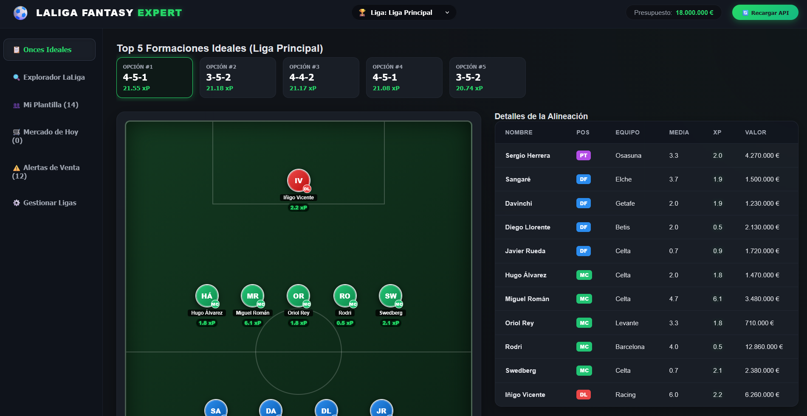
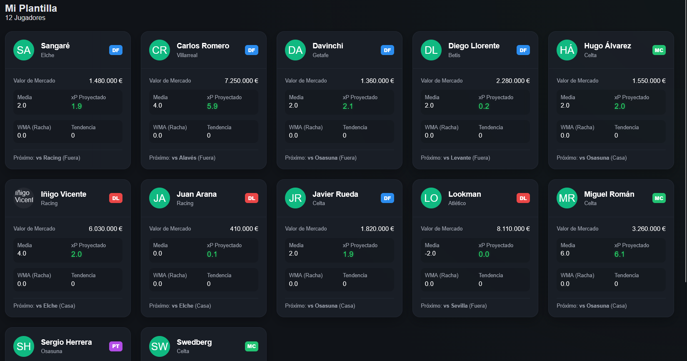
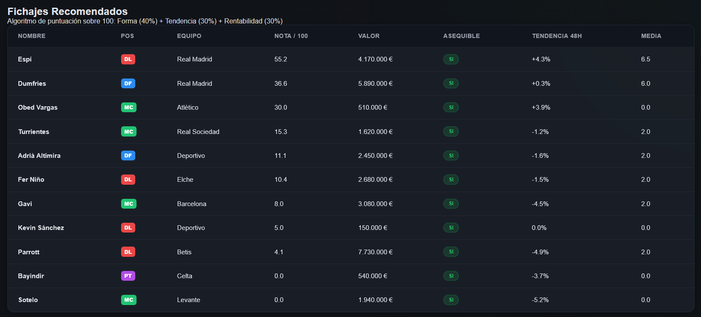
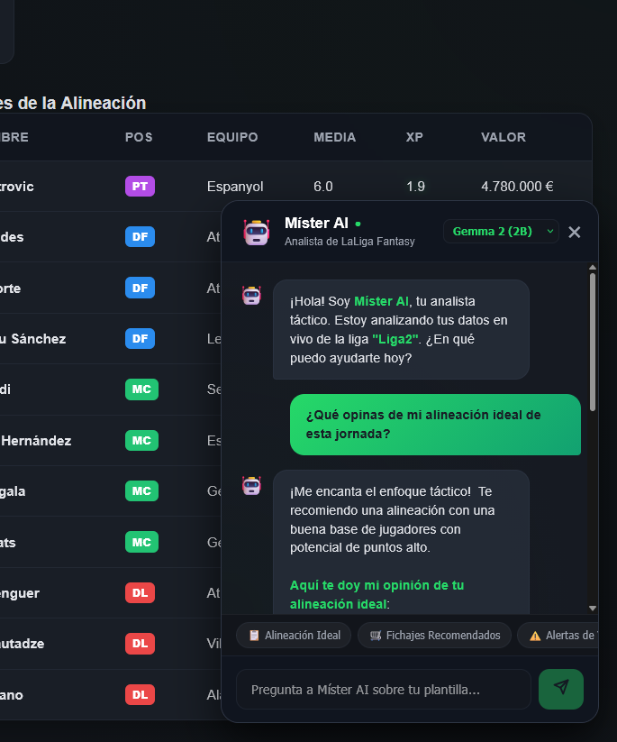

# LALIGA FANTASY EXPERT ASSISTANT


Herramienta analítica avanzada para dominar en **LaLiga Fantasy**. Utiliza Machine Learning (XGBoost) para predecir el rendimiento de los jugadores por posición táctica, optimiza tus alineaciones mediante fuerza bruta combinatoria, incluye un **Chatbot de IA Local con Ollama** y te asesora en el mercado con una interfaz interactiva moderna.

### Vista Previa de la Interfaz





---

## Funcionalidades Principales

- **Chatbot Analista de IA Local ("Míster AI"):** asistente conversacional integrado con **Ollama** (`gemma2:2b`, `llama3.2:1b`, `llama3`). Inyecta en tiempo real los datos en vivo de tu liga activa (plantilla, xP XGBoost, mercado diario y presupuesto) para responder a tus dudas tácticas en lenguaje natural con formateo de negritas Markdown y selector de modelos.
- **Sistema Multiliga Independiente:** administra perfiles para múltiples ligas paralelas (`data/leagues.json`) desde un desplegable en el Header, manteniendo aisladas las plantillas, mercados y predicciones de cada una.
- **Motor Multi-Modelo XGBoost (xP):** entrena **4 modelos de IA independientes** especializados por posición (`PT`, `DF`, `MC`, `DL`). Analiza la racha ponderada (WMA), la tendencia de aceleración, la consistencia, el próximo rival y la localía.
- **Onces Ideales con Tablero Táctico 2D:** examina miles de combinaciones tácticas cruzando todas las formaciones legales. La interfaz web renderiza un campo de fútbol interactivo en el que se ubican los jugadores según el esquema elegido.
- **Algoritmo de Fichajes:** puntúa a los jugadores disponibles del mercado de 0 a 100 evaluando la Forma Reciente (WMA 40%), Tendencia de Mercado (30%) y Rentabilidad (30%).
- **Alertas de Fuga de Valor:** detecta automáticamente caídas de valor (>2%) o lesionados para recomendarte ventas inmediatas en un panel de alertas visual.
- **Base de Datos Acumulativa de Aprendizaje:** guarda el histórico en `data/historico_aprendizaje.csv` asociando predicciones pasadas con resultados exactos finales conforme avanzan las jornadas para refinar el modelo.

---

## Estructura del Proyecto

```text
 fantasy/
├── app.py                # Servidor Backend (FastAPI API REST + Endpoint Ollama /api/chat)
├── main.py               # Ejecutador CLI tradicional
├── run_web.ps1           # Script de arranque rápido (un solo click)
├── core/                 # Lógica de negocio (Python)
│   ├── model.py             # Entrenamiento y predicciones XGBoost (4 modelos)
│   ├── data_manager.py      # Gestión de persistencia, snapshots y WMA/volatilidad
│   ├── scraper.py           # Descarga de datos oficiales de Biwenger + fixtures
│   ├── analyzer.py          # Optimizador de alineaciones y recomendador de fichajes
│   └── utils.py             # Utilidades de lectura y búsqueda difusa (Fuzzy Search)
├── data/                 # Directorio de persistencia local (ignorado en Git)
│   ├── leagues.json         # Perfiles multiliga (plantillas y mercados independientes)
│   ├── mi_plantilla.txt     # Tu equipo activo (sincronizado)
│   ├── mercado_hoy.txt      # Mercado activo (sincronizado)
│   └── historico_aprendizaje.csv # Registros de aprendizaje XGBoost
└── frontend/             # Aplicación de Interfaz Web (React)
    ├── src/
    │   ├── App.jsx       # Lógica UI (Tablero 2D, ChatWidget Míster AI y Paneles)
    │   ├── App.css       # Estilo HSL (Modo oscuro, chat neón y glassmorphism)
    │   └── main.jsx      # Punto de entrada de React
    └── package.json      # Dependencias del frontend
```

---

## Instrucciones de Instalación y Uso

### 1. Instalación de dependencias
Asegúrate de tener Python 3.11+, Node.js y [Ollama](https://ollama.com/) instalados en tu sistema. Luego, instala los requisitos del backend:
```bash
pip install -r requirements.txt
```

Y las dependencias del frontend:
```bash
cd frontend
npm install
cd ..
```

### 2. Ejecutar la Aplicación Web (Backend + Frontend)
En una terminal de **PowerShell**, ejecuta el script de arranque:
```powershell
.\run_web.ps1
```
* Este script levantará la API de FastAPI en segundo plano (`http://localhost:8000`).
* Servirá la interfaz web de React en `http://localhost:5173/`, abriéndose automáticamente en tu navegador predeterminado.
* Para usar el **Chatbot Míster AI**, asegúrate de tener el servicio de Ollama activo con tu modelo preferido (ej. `ollama run gemma2:2b`).

---

## Licencia

Este proyecto está licenciado bajo la **GNU General Public License v3.0 (GPLv3)**. Consulta el archivo [LICENSE](LICENSE) para más detalles.